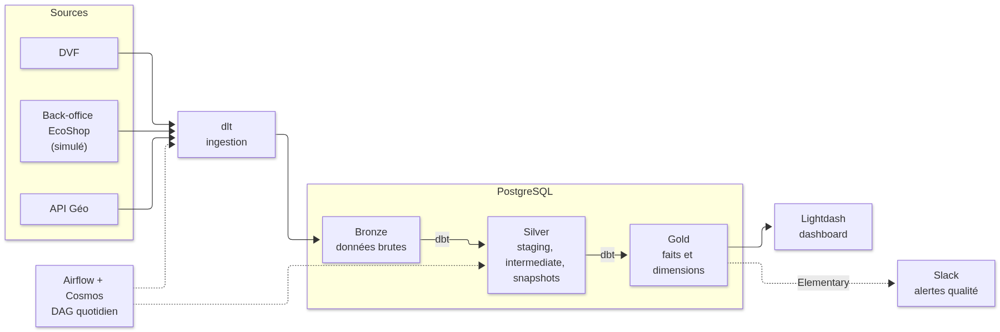
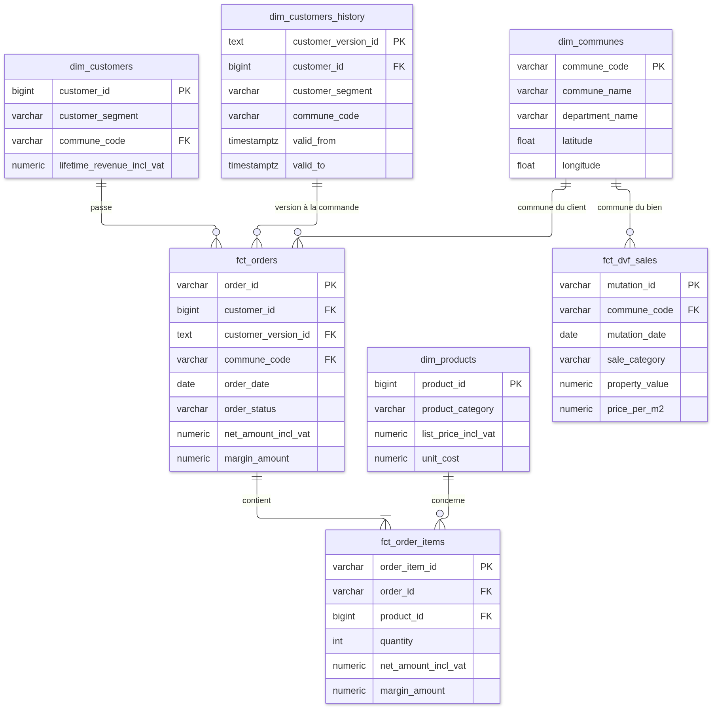
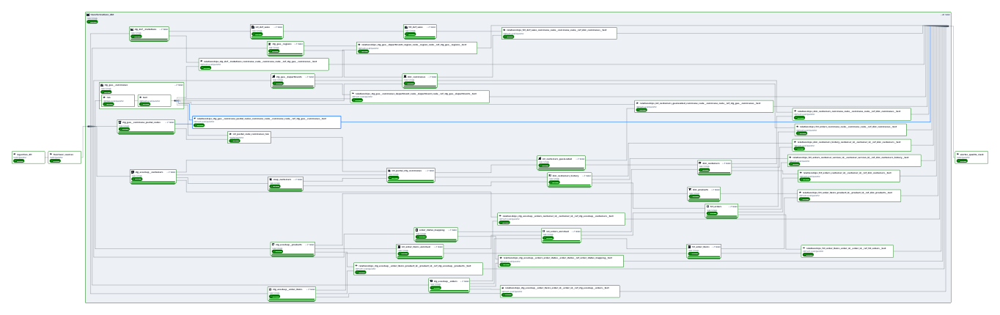
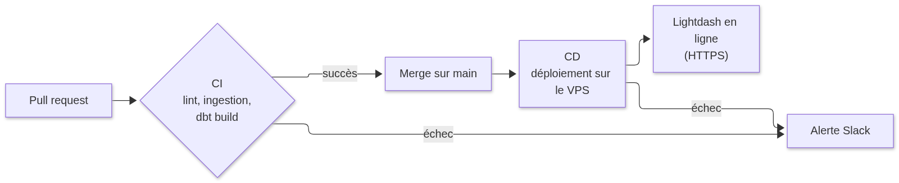
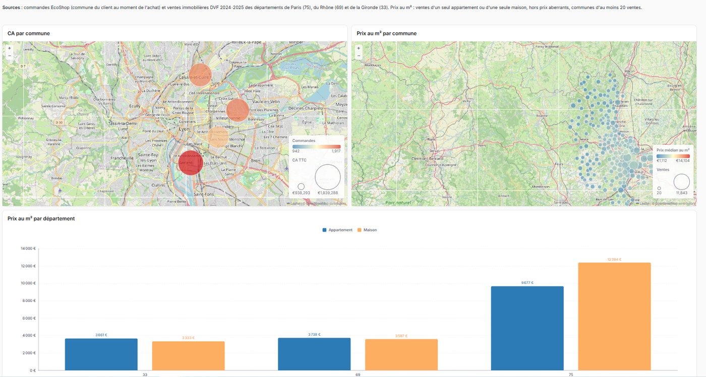
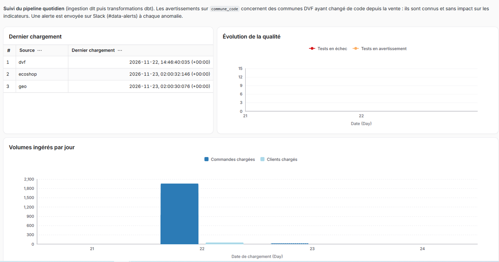

# EcoShop Analytics

Plateforme analytique de bout en bout : ingestion, modélisation, orchestration,
restitution et déploiement continu.

[](https://www.python.org)
[](https://dlthub.com)
[](https://www.postgresql.org)
[![dbt](https://img.shields.io/badge/dbt-FF694B?style=for-the-badge&logo=data%3Aimage%2Fsvg%2Bxml%3Bbase64%2CPHN2ZyBmaWxsPSJ3aGl0ZSIgcm9sZT0iaW1nIiB2aWV3Qm94PSIwIDAgMjQgMjQiIHhtbG5zPSJodHRwOi8vd3d3LnczLm9yZy8yMDAwL3N2ZyI%2BPHRpdGxlPmRidDwvdGl0bGU%2BPHBhdGggZD0iTTE3LjkwMDQgOS4zNzYzYTguMTQ4OCA4LjE0ODggMCAwIDAtMy4wNDIxLTMuMTIwNmwxLjc3MDguODM4NWExMC4yODc0IDEwLjI4NzQgMCAwIDEgMy43NCAzLjAwMDdsMy4yMzQtNS45Mjk1YTIuODU0NiAyLjg1NDYgMCAwIDAtLjA2MTEtMi45NjA0QzIyLjc1NjYuMDM3MSAyMS4yMTEyLS4zNDA5IDE5Ljk3NTQuMzMyN2wtNS44NzQ5IDMuMjEwMWE0LjM2MTIgNC4zNjEyIDAgMCAxLTQuMTc2MSAwTDQuMTc2OS40MDhhMi44NTQ1IDIuODU0NSAwIDAgMC0yLjk1OTIuMDYzMmMtMS4xNjczLjc4NTMtMS41NDUyIDIuMzMtLjg3MjMgMy41NjU1TDMuNTUgOS45MTA2YTQuMzYxMiA0LjM2MTIgMCAwIDEgMCA0LjE3NzJsLTMuMTI3MiA1Ljc0M2EyLjg2IDIuODYgMCAwIDAgLjA4NSAyLjk5NzRjLjc5NCAxLjE0MzggMi4zMjI1IDEuNTA1NCAzLjU0NDguODM4NWw2LjA1ODEtMy4zMDQ5YTEwLjI4NzcgMTAuMjg3NyAwIDAgMS0zLjAwNTEtMy43NDU0bC0uODM3NC0xLjc3MDhhOC4xNDggOC4xNDggMCAwIDAgMy4xMjA2IDMuMDQyMWwxMC41ODMyIDUuNzc5YzEuMjIxMy42NjYgMi43NDgxLjMwNTUgMy41NDI2LS44MzYzYTIuODY5OSAyLjg2OTkgMCAwIDAgLjA3OTYtMy4wMDE4TDE3LjkwMDQgOS4zNzYzem0zLjM4MDEtNy43MzUxYy42MDIyIDAgMS4wOTA0LjQ4ODIgMS4wOTA0IDEuMDkwNHMtLjQ4ODIgMS4wOTA0LTEuMDkwNCAxLjA5MDQtMS4wOTA0LS40ODgyLTEuMDkwNC0xLjA5MDQuNDg4Mi0xLjA5MDQgMS4wOTA0LTEuMDkwNHpNMi43NDQyIDMuODIyYy0uNjAyMiAwLTEuMDkwNC0uNDg4Mi0xLjA5MDQtMS4wOTA0cy40ODgyLTEuMDkwNCAxLjA5MDQtMS4wOTA0IDEuMDkwNC40ODgyIDEuMDkwNCAxLjA5MDRTMy4zNDY0IDMuODIyIDIuNzQ0MiAzLjgyMnptMCAxOC41MzYzYy0uNjAyMiAwLTEuMDkwNC0uNDg4Mi0xLjA5MDQtMS4wOTA0IDAtLjYwMjIuNDg4Mi0xLjA5MDQgMS4wOTA0LTEuMDkwNHMxLjA5MDQuNDg4MiAxLjA5MDQgMS4wOTA0YzAgLjYwMjItLjQ4ODIgMS4wOTA0LTEuMDkwNCAxLjA5MDR6bTEwLjM1ODUtMTEuNDQ4OWMtMS4yMDA4LS4wMDM1LTIuMTc3Ljk2NzItMi4xODA1IDIuMTY3OWEyLjE3MzggMi4xNzM4IDAgMCAwIC43MDUyIDEuNjA5MWMtMS40ODcyLS4yMDkxLTIuNTIzNC0xLjU4NDMtMi4zMTQyLTMuMDcxNi4yMDkxLTEuNDg3MiAxLjU4NDMtMi41MjM0IDMuMDcxNi0yLjMxNDJhMi43MTk0IDIuNzE5NCAwIDAgMSAyLjMxNDIgMi4zMTQyIDIuMTYyMyAyLjE2MjMgMCAwIDAtMS41OTYzLS43MDU0em04LjE3NzggMTEuNDQ4OWMtLjYwMjIgMC0xLjA5MDQtLjQ4ODItMS4wOTA0LTEuMDkwNCAwLS42MDIyLjQ4ODItMS4wOTA0IDEuMDkwNC0xLjA5MDRzMS4wOTA0LjQ4ODIgMS4wOTA0IDEuMDkwNGMwIC42MDIyLS40ODgyIDEuMDkwNC0xLjA5MDQgMS4wOTA0eiIvPjwvc3ZnPg%3D%3D&logoColor=white)](https://www.getdbt.com)
[](https://airflow.apache.org)
[](https://www.lightdash.com)
[](https://www.docker.com)
[](https://github.com/features/actions)

## Démo en ligne

**https://ecoshop-analytics.duckdns.org** (lecture seule)

| Identifiant | Mot de passe |
|---|---|
| `demo@ecoshop-analytics.duckdns.org` | `EcoShopDemo2026` |

Ouvrir le dashboard **EcoShop Analytics**. Les données sont mises à jour chaque nuit.


## Contexte et objectif

EcoShop est une boutique en ligne française fictive. Sa direction veut suivre son
activité (chiffre d'affaires, marge, clients) et la mettre en regard du marché
immobilier des villes où vivent ses clients.

L'objectif du projet est de construire une chaîne de données complète et automatisée :

- **ingérer** trois sources hétérogènes (back-office, API, fichiers Open Data) ;
- **modéliser** les données en couches (Bronze, Silver, Gold) jusqu'à un modèle
  dimensionnel testé et historisé ;
- **orchestrer** le traitement chaque nuit et **alerter** en cas d'anomalie ;
- **restituer** les indicateurs dans un dashboard accessible en ligne ;
- **déployer** automatiquement chaque évolution validée.

## Jeux de données

| Source | Nature | Contenu | Volume |
|---|---|---|---|
| Back-office EcoShop | Simulée | Clients, produits, commandes et lignes de commande depuis janvier 2025 | 500 clients, 80 produits, environ 21 000 commandes |
| [API Géo](https://geo.api.gouv.fr) | Réelle, API publique | Communes, départements et régions de France, avec population et coordonnées GPS | 35 000 communes |
| [DVF géolocalisées](https://files.data.gouv.fr/geo-dvf/) | Réelle, Open Data | Ventes immobilières 2024-2025 de Paris, du Rhône et de la Gironde | 515 000 lignes, 200 000 ventes |

Le back-office est produit par un simulateur déterministe qui fait évoluer les données
dans le temps : nouvelles commandes, changements de statut, montée en gamme et
déménagement des clients. Il permet de mettre en œuvre le chargement incrémental et
l'historisation des clients sur des données qui changent réellement.

## Architecture



<sub>Source du schéma : [docs/diagrams/architecture.mmd](docs/diagrams/architecture.mmd)</sub>

| Rôle | Outil |
|---|---|
| Ingestion | dlt |
| Entrepôt | PostgreSQL 16 |
| Transformation et tests | dbt Core 1.12, dbt_utils, Elementary |
| Orchestration | Airflow 3.3 + Astronomer Cosmos |
| Restitution | Lightdash (couche sémantique définie dans dbt) |
| Infrastructure | Docker Compose, GitHub Actions, VPS |

## Modèle de données

Modèle en constellation : plusieurs tables de faits (commandes, lignes de commande et
ventes immobilières) partagent des dimensions communes. La dimension géographique
`dim_communes`, commune aux commandes et aux ventes immobilières, permet de croiser le
chiffre d'affaires et le prix au m² d'une même commune.



<sub>Source du schéma : [docs/diagrams/modele-donnees.mmd](docs/diagrams/modele-donnees.mmd)</sub>

| Couche | Contenu |
|---|---|
| Bronze | Tables chargées par dlt, sans transformation |
| Silver | Nettoyage et typage (staging), règles métier (intermediate), historique des clients (snapshot SCD2) |
| Gold | Faits et dimensions ci-dessus, exposés à Lightdash |

## Points clés

- **Chargement incrémental** : fusion sur clé pour le back-office, remplacement par
  fichier pour DVF (republié chaque semestre), référentiel rechargé en entier.
- **Historisation SCD2** des clients : chaque commande est rattachée au segment et à
  l'adresse du client à la date de l'achat.
- **Table de faits incrémentale** avec contrat de modèle (colonnes et types garantis).
- **Qualité** : plus de 100 tests (génériques, métier, unitaires, détection
  d'anomalie de volume) et contrôle de fraîcheur des sources.
- **Observabilité** : résultats historisés par Elementary, alertes Slack en français.
- **Orchestration** : une tâche Airflow par modèle dbt grâce à Cosmos.
- **CI/CD** : chaque pull request est testée sur une base vide ; chaque merge est
  déployé automatiquement en production.

## Orchestration et alertes

Le DAG `ecoshop_quotidien` s'exécute chaque nuit : ingestion, contrôle de fraîcheur,
transformations dbt (une tâche par modèle, suivie de ses tests), puis synthèse qualité.



Toute anomalie est signalée sur Slack :


## Déploiement



<sub>Source du schéma : [docs/diagrams/deploiement.mmd](docs/diagrams/deploiement.mmd)</sub>

En production, chaque service tourne dans un conteneur Docker avec une limite mémoire.
Seul le dashboard est exposé, en HTTPS derrière un reverse proxy ; l'entrepôt et
l'interface Airflow ne sont pas accessibles depuis Internet. Les secrets restent sur le
serveur et dans GitHub, jamais dans le code.

## Questions métier et dashboard

Chaque graphique du dashboard répond à une question précise.

### Vue exécutive

| Graphique | Question |
|---|---|
| CA TTC | Combien la boutique a-t-elle vendu depuis son ouverture ? |
| Taux de marge | Quelle part du chiffre d'affaires HT reste-t-il après le coût d'achat ? |
| Panier moyen | Combien un client dépense-t-il en moyenne par commande ? |
| Commandes | Combien de commandes ont été expédiées ou livrées ? |
| CA mensuel | Le chiffre d'affaires et la marge progressent-ils d'un mois à l'autre ? |
| CA par segment | Quels segments de clients génèrent le chiffre d'affaires au moment de l'achat ? |

### Cartographie France

| Graphique | Question |
|---|---|
| CA par commune | Dans quelles villes vivent les clients qui rapportent le plus ? |
| Prix au m² par commune | Où l'immobilier est-il le plus cher dans les départements suivis ? |
| Prix au m² par département | Combien coûte le m² d'un appartement ou d'une maison selon le département ? |



### Clients et rétention

| Graphique | Question |
|---|---|
| Clients par segment | Comment le portefeuille se répartit-il entre clients Standard, Premium et VIP ? |
| Commandes par client | Combien de fois un client commande-t-il en moyenne ? |
| Commandes par segment et par mois | La part des clients Premium et VIP progresse-t-elle dans les ventes ? |
| Top 10 clients | Quels clients rapportent le plus de chiffre d'affaires ? |
| Répartition du nombre de commandes | Les clients achètent-ils une seule fois ou de manière régulière ? |


### Qualité et fraîcheur

| Graphique | Question |
|---|---|
| Dernier chargement | Les données de chaque source sont-elles à jour ? |
| Volumes ingérés par jour | Le pipeline a-t-il chargé un volume habituel de données ? |
| Tests en anomalie | Quels contrôles de qualité sont en échec ou en avertissement, et sur quelles tables ? |
| Évolution de la qualité | La qualité des données se dégrade-t-elle au fil des jours ? |



## Structure du dépôt

```
├── pipelines/          # Ingestion dlt (trois sources) et simulateur du back-office
├── dbt_project/        # Modèles, tests, snapshot, macros et couche sémantique
├── airflow/            # Image Airflow et DAG quotidien
├── lightdash/          # Graphiques et dashboard versionnés en YAML
├── scripts/            # Alertes Slack et déploiement
├── notebooks/          # Exploration et contrôles
├── docs/               # Captures et schémas (sources Mermaid dans docs/diagrams)
└── .github/workflows/  # CI et CD
```

## Auteur

**Martial GADJEU** | Data & AI Engineer
